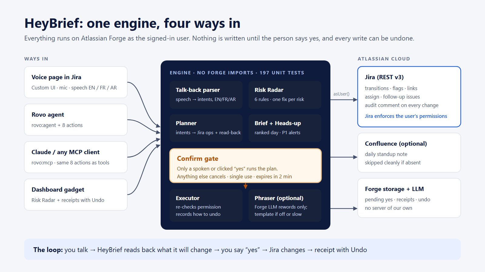

# HeyBrief

**From detecting external events to understanding their internal impact and coordinating the response.** HeyBrief is a voice-first Forge app: when a P1 lands or a vendor (GitHub, Cloudflare, npm...) goes down, it names the open work and the release at risk, proposes one response plan, and runs it only after your spoken yes, with Undo. Day to day: say your status out loud and Jira updates itself after your yes; Risk Radar proposes the fix, not just the alarm. Built for Atlassian Codegeist 2026 (Apps for Software Teams, bonus: Best app with Atlassian MCP).

**[Install HeyBrief on your Jira Cloud site](https://developer.atlassian.com/console/install/97ce7671-faa4-49b0-9eb4-30f946f590c9?signature=AYABeGcyoEe50Nk4uImGnTKVjckAAAADAAdhd3Mta21zAEthcm46YXdzOmttczp1cy13ZXN0LTI6NzA5NTg3ODM1MjQzOmtleS83MDVlZDY3MC1mNTdjLTQxYjUtOWY5Yi1lM2YyZGNjMTQ2ZTcAuAECAQB4CxqLTo9l4lqXuFjNim1xJM%2Bp%2F3TVP9xHS2BrU5DRRucBFX86iUC7xrSrHpZxjxFcwAAAAH4wfAYJKoZIhvcNAQcGoG8wbQIBADBoBgkqhkiG9w0BBwEwHgYJYIZIAWUDBAEuMBEEDA7NF38nUecAFhuPTgIBEIA7nYWoShu%2Bn9JkLoZTkeiy%2FzB%2FqQZ62XT4AVKhckqZNzuQwxsyUwCgNHG%2FHpHF2Mvsn%2F2ROEmjIRnxuHEAB2F3cy1rbXMAS2Fybjphd3M6a21zOmV1LXdlc3QtMTo3MDk1ODc4MzUyNDM6a2V5LzQ2MzBjZTZiLTAwYzMtNGRlMi04NzdiLTYyN2UyMDYwZTVjYwC4AQICAHi9bVMAkme4qVQX1fQHo6ePw3H40A7cGfz7yrmSfBWMXgFVVHcIxPpQLw92BjCRxn5IAAAAfjB8BgkqhkiG9w0BBwagbzBtAgEAMGgGCSqGSIb3DQEHATAeBglghkgBZQMEAS4wEQQMJL%2Bbu%2FH9%2FP8TqT2uAgEQgDsLXaVuiEtJK9ySvlccKtD0GoEpZcwejap7Dn2Ggst4xVymJK0M61BYpMbUNRkwuG4RNdt%2FEFsjKw1BwgAHYXdzLWttcwBLYXJuOmF3czprbXM6dXMtZWFzdC0xOjcwOTU4NzgzNTI0MzprZXkvNmMxMjBiYTAtNGNkNS00OTg1LWI4MmUtNDBhMDQ5NTJjYzU3ALgBAgIAeDYASx0XCjkny4iLV6vz%2BKtEGSGT6kdt0QRpkn6D%2FlVEAb7nWwg52uJltNAtTGCHb7YAAAB%2BMHwGCSqGSIb3DQEHBqBvMG0CAQAwaAYJKoZIhvcNAQcBMB4GCWCGSAFlAwQBLjARBAx87%2BdrctIpWIOeykUCARCAO1W3fANHCohDMeKERY%2BXovVt3brRDOPl3o1m6R%2FewQ3cnYKUU3NKgtoEbH5h44mor3IFhZdmwQ9%2BDUq6AgAAAAAMAAAQAAAAAAAAAAAAAAAAAN0qPjKrLeqkPKjjmKMdnnr%2F%2F%2F%2F%2FAAAAAQAAAAAAAAAAAAAAAQAAADJCHAZ7YvjR43Fatgh0zByvNPbpqRCxDFXW2Eqe01ki63kXfd%2FR%2BFzNHrYuEXAbI0XtyAyueHRtKxVxUeF9oI6MVUo%3D&product=jira)**, then open Apps > HeyBrief and click Load demo data. The 5-minute test is in [docs/JUDGE_SCRIPT.md](docs/JUDGE_SCRIPT.md).



One engine, four ways in, all running as the signed-in user so Jira enforces permissions:

| Door | Module | Runs as |
|---|---|---|
| Voice page in Jira | `jira:globalPage` (Custom UI): mic, spoken answers, Yes/Cancel, live board, receipt | `asUser()` |
| Rovo chat | `rovo:agent` + 7 `action`s | `asUser()` |
| Claude / any MCP client | `rovo:mcp` (same 7 actions) | `asUser()` |
| Desk | `jira:dashboardGadget` (drive receipt + Risk Radar), `jira:personalSettingsPage` (projects, demo data) | `asUser()` |

Not shipped: a hands-free phone door is on the roadmap after Codegeist. Its server code is kept and tested but is not exported or in the manifest, so it is not part of this app (`docs/ROADMAP_SIRI.md`).

**Try it without Jira:** `npm run build` writes `dist/heybrief-voice.html`, the same voice console running the real engine over a simulated demo project. Open it in Chrome.

## Layout

```
src/engine/        no @forge imports; 100% unit tested with fakes
  talkback/        parse.ts (spoken update -> intents, EN/FR/AR), plan.ts (intents -> Jira ops + read-back)
  confirm.ts       confirm-before-write gate: 2-min expiry, single use, per user, anything but yes cancels
  execute.ts       runs ops, re-checks permission, resolves transitions at run time, records undo
  risk/            radar.ts (6 deterministic signals, score, one fix per risk), speak.ts (speech + "why?")
  brief/drive.ts   brief sized to the minutes you have
  siri/auth.ts     roadmap: pairing tokens (SHA-256 hash only), rate limit, body validation
  permissions.ts   roadmap (Siri door): bulk check, automatic fallback, fail closed
  receipt.ts       plain-language drive receipt lines
  demo/data.ts     deterministic demo project (exactly 3 risks, judge-script issues)
  demo/seed.ts     one-click seeder for a real site, with simulated history
  testing/fakes.ts FakeJira, FakeConfluence, MemoryStore, FixedClock
  heybrief.ts      use cases every door calls; route() for free speech
src/forge/         adapters: jira.ts (REST v3), confluence.ts, store.ts (KVS), llm.ts (@forge/llm + guardrail)
src/doors/         rovo.ts (actions = MCP tools), resolvers.ts (voice page, gadget, settings), siri.ts (roadmap)
src/frontend/      UI Kit: gadget.tsx, settings.tsx
  voice/           voice console (plain DOM): ui.ts, listeners.ts (dictation / Web Speech), forge.ts, local.ts + proto.ts
scripts/           build-voice.mjs: builds static/voice/build (Forge) and dist/heybrief-voice.html (prototype)
test/              Vitest, 205 tests
docs/              JUDGE_SCRIPT.md (5-minute judge test), ROADMAP_SIRI.md (after Codegeist, not shipped)
```

## Commands

```
npm install
npm run check        # typecheck + tests + build the voice page (forge deploy needs static/voice/build)
forge register       # first time only: writes the real app.id into manifest.yml
forge deploy && forge install --site <your-site>.atlassian.net --product jira
```

The manifest validates against `@forge/manifest`'s JSON schema. `forge lint` needs `forge login`.

## Response plan

When Heads-up catches an unowned P1 or a vendor outage that touches open work, HeyBrief proposes one plan instead of one action. P1: assign it to you, start it, tell the team, and open a post-incident review. Vendor outage: note it on each affected issue and notify its owner, and open a tracking issue. If an issue involved is on a release (fix version) that ships within 7 days, the plan says that release is at risk. It is deterministic rules, not a prediction, and nothing runs before your yes. `src/engine/alert/plan.ts`.

## What a fresh install needs

Nothing beyond **Load demo data** (voice page side panel, or Personal settings > HeyBrief). Specifically:

- **No Forge LLM? Still works.** Every answer has a deterministic template. The LLM only rewords it (4.5 s timeout), and a guardrail drops any rewording that invents an issue key.
- **No Confluence? Still works.** The standup note is optional: it is skipped until a space key is set in HeyBrief settings. If Confluence is missing or the space is wrong, the receipt says so in plain words and every Jira change still lands.
- **No permission? Said out loud.** Everything runs as the signed-in user, the executor re-checks permission before each write, and a refused change shows "you do not have permission for this in Jira", never raw HTTP text.

## Verified live (13-14 Nov 2026, demo site, through Atlassian MCP)

my-day, read-issue, risk-radar, explain-risk, urgent-alerts (French), voice-standup + confirm-change (a real write after "yes", and a cancel that changed nothing). 205 unit tests, all green (`npm run check`).

## Voice in English, French and Arabic

The language menu on the voice page sets both the microphone language (en-US, fr-FR, ar-TN) and the spoken voice. HeyBrief picks the best installed voice for that language (natural/online voices first, Tunisian Arabic first) and never reads French or Arabic with an English voice: if none is installed, the page says so, shows how to add one, and answers in text.

| Browser | Mic in French / Arabic | Spoken French | Spoken Arabic |
|---|---|---|---|
| Microsoft Edge (Windows, Mac) | Yes | Yes (online natural voices) | Yes (online natural voices, incl. Tunisian) |
| Chrome on Windows | Yes | Yes (Google voice) | Only if a Windows Arabic voice is installed |
| Chrome on Mac | Yes | Yes | Yes, with the macOS Arabic voice (Majed) downloaded |
| Chrome on Android | Yes | Yes | Yes, with Arabic in Google text-to-speech |
| Safari (Mac, iPhone) | Patchy | Yes | Yes, with an Arabic voice downloaded |
| Firefox | No (typing only) | Yes, with OS voices | With OS voices |

For the demo video, use Edge.
